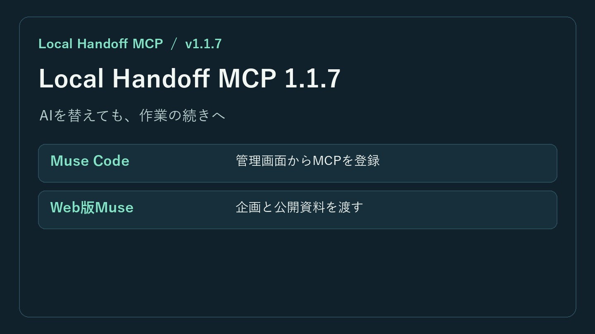

# Local Handoff MCP / AI開発エージェントのローカル引き継ぎ

Local Handoff MCP lets you continue a project when you switch AI development agents on the same PC. Open the same project folder in the next client and check the saved goal, completed work, current owner, and next action. Checkpoints are stored locally in SQLite.

Local Handoff MCPは、同じPCでAI開発エージェントを切り替えても、同じ作業フォルダーで続きを進められるツールです。次のAIは、保存された目的、済んだ作業、担当、次の操作を確認してから再開します。チェックポイントはPC内のSQLiteに保存します。

The dashboard detects supported installations of Codex, Antigravity, Claude Code, OpenCode, Strata, and Muse Code. It also shows Ollama and LM Studio as local model runtimes. The video covers installation, client setup, a Codex-to-Antigravity handoff, project filters, scheduled Git observations, and a separate Web Muse example.

管理画面では、Codex、Antigravity、Claude Code、OpenCode、Strata、Muse Codeの導入・接続状況と、ローカルモデル実行環境のOllama・LM Studioを確認できます。紹介動画では、導入、AIの接続、CodexからAntigravityへの引き継ぎ、案件の絞り込み、Git状態の定期観測、Web版Museの4コマ作例を紹介します。

## Narrated demo / ナレーション付き紹介動画

[](https://github.com/FURUYAN1234/local-handoff-mcp/releases/download/v1.1.7/Local-Handoff-MCP-v1.1.7.mp4)

[Download the overview video (MP4) / 全体紹介動画をダウンロード（MP4）](https://github.com/FURUYAN1234/local-handoff-mcp/releases/download/v1.1.7/Local-Handoff-MCP-v1.1.7.mp4)

[Watch the overview on YouTube / YouTubeで全体紹介を見る](https://youtu.be/aoI4K3WXlvE)

## Install / インストール

Download the ZIP from [GitHub Releases](https://github.com/FURUYAN1234/local-handoff-mcp/releases), extract it, run `Install.bat`, and register a project folder. For later releases, run the batch from the newly extracted ZIP. Existing work records and client registrations carry forward. / GitHub ReleasesからZIPを取得し、展開して `Install.bat` を起動し、作業フォルダーを登録します。更新時は新版ZIPのバッチを実行すると、記録と両クライアントの登録を引き継ぎます。

The installer requires Windows, WSL 2 Ubuntu, Python 3.11+ and the corresponding clients. / インストーラーにはWindows、WSL 2 Ubuntu、Python 3.11以上、および対象クライアントが必要です。

[User and MCP setup guide / 操作・MCP設定マニュアル](MANUAL.md) · [Japanese paper / 日本語論文](paper-ja.md) · [English paper / 英語論文](paper-en.md) · [Release maintenance / リリース時の文書更新](RELEASE-PROCESS.md)

[note article and Drive download / 紹介noteとDriveダウンロード](https://note.com/happy_duck780/n/n806c7bc6de94)

## Dashboard and checkpoints / 管理画面とチェックポイント

This guide and the video cover v1.1.7. / この節と紹介動画ではv1.1.7を使います。

Switch between English and Japanese in the dashboard header. AI connections are checked every minute while the tab is visible. Use How to add projects in the project list for workspace registration and the first checkpoint. / 管理画面のヘッダーから英語・日本語を切り替えられます。表示中はAIの接続状況を1分ごとに確認します。「プロジェクトの追加方法」から作業フォルダーの登録と初回チェックポイントの手順を確認できます。

Each setup guide has one Copy request button for its task. To share all instructions, open Full manual and select Copy full manual. From AI connections, Ask an agent to register apps prepares a request to connect supported apps already installed on this PC. / 各設定ページの「依頼文をコピー」から、その作業だけをAIに頼めます。手順をまとめて渡すには「マニュアル全体」を開き、「マニュアル全体をコピー」を使います。「接続先のAI」の「AIに一括登録を依頼」では、このPCに導入済みの対応アプリへ登録するための依頼文をコピーできます。

1. **Open the dashboard / 管理画面を開く** — After installation, double-click Dashboard.bat. The dashboard opens in your browser and reads handoff records on your PC. / インストール後、Dashboard.bat をダブルクリックします。ブラウザーが開き、このPCの引き継ぎ記録を表示します。
2. **Open it again / 開き直す** — After closing the browser tab, double-click the same Dashboard.bat. It reuses the running server or starts it if necessary. You can create a desktop shortcut to this batch. / タブを閉じたあとも、同じ Dashboard.bat をダブルクリックします。起動中なら同じサーバーを使い、停止中なら起動します。よく使う場合はデスクトップにショートカットを作れます。
3. **Check AI connections / AIの接続を確認する** — The dashboard checks for Codex, Antigravity, Claude Code, OpenCode, Muse Code and Strata. It shows installation, MCP registration and known sign-in status. LM Studio and Ollama appear as local model runtimes. / Codex、Antigravity、Claude Code、OpenCode、Muse Code、Strataの導入有無、MCP登録、取得できた認証状態を表示します。LM StudioとOllamaはローカルモデルの実行環境として表示します。
4. **Connect Claude Code / Claude Codeをつなぐ** — Choose Register MCP in the Claude Code row, reopen Claude Code and check /mcp. For sign-in, follow the dashboard's button and instructions for your Claude Code version. / Claude Codeの欄で「MCPを登録」を選びます。Claude Codeを開き直して /mcp で接続を確認します。認証が必要なときは、管理画面に表示された版別の操作に従います。未導入のデスクトップアプリは「アプリを取得」から公式配布ページを開けます。OpenCode CLIはx64版WSLなら「OpenCode CLIをインストール」で導入できます。各AIの「MCP手順を見る」では、そのAIへの接続手順が開きます。

A project appears after its first checkpoint is saved. Displayed times use the browser time zone, and checkpoint translations appear when saved for the selected language. / 最初のチェックポイントを保存した作業フォルダーが一覧に表示されます。時刻はブラウザーのタイムゾーンに合わせ、選んだ言語の訳文が保存されている場合はその訳文を表示します。

Use the project filters to find a handoff and open its history. The dashboard can be stopped independently of MCP handoffs. / 案件名や状態で絞り込み、案件名を選ぶと履歴が開きます。管理画面を閉じている間も、各AIのMCPから引き継ぎを使えます。

Run Autosave.bat once or use Windows Task Scheduler to repeat it. It records changes to Git metadata for active projects and preserves the owner's written checkpoint. / Autosave.bat は単回実行やWindowsタスク スケジューラによる定期実行に使えます。担当がいる案件でGitの状態を観測し、担当が手動・MCPで保存したチェックポイントはそのまま参照できます。

## Muse Code and the web workflow / Muse CodeとWeb版Museの使い方

**Muse Code on this PC / このPCのMuse Code** · Install the official CLI, choose Register MCP in the Muse Code row, and open a registered project in Muse Code. Ask it to run `handoff_status`. Use `muse-code` as the recipient when offering a handoff. See [Meta sign-in and billing](https://dev.meta.ai/docs/muse-code/auth) for model access. / 公式CLIを導入し、管理画面のMuse Code欄で「MCPを登録」を押します。Muse Codeで登録済みの作業フォルダーを開き、`handoff_status` を実行するよう頼みます。引き渡し先は `muse-code` です。モデルを利用する条件は[Metaの認証と料金の案内](https://dev.meta.ai/docs/muse-code/auth)を確認してください。

**Example / 作例** · Ask [Muse on the web](https://muse.ai/) for a comic premise and public sources. Paste both into [Dots](https://help.openai.com/en/articles/20001530-getting-started-with-your-dot) to arrange the brief and delegate production setup to Codex, or paste them directly into Codex on this PC. In the registered local project, ask Codex to save the brief and next step with `handoff_checkpoint`. Muse Code or Strata can resume the project on the same PC. / Web版Museで漫画のネタと出典を集め、Dotsに貼って企画を整理し、Codexに制作準備を依頼します。このPCのCodexに直接貼る方法もあります。登録済みの作業フォルダーでCodexが企画と次の工程を記録し、必要に応じてMuse CodeやStrataが続きに入ります。

[Open the sunset comic storyboard / 夕焼けの4コマ作例を見る](docs/sunset-comic.md) · [Copy the research request from the web workflow instructions / Web連携の手順と作例用の依頼文を見る](MANUAL.md#work-with-muse-on-the-web--web版museとの連携)

**Ollama in OpenCode / OpenCodeでOllamaを使う** · Start Ollama, open the OpenCode client on the same OS, and select an Ollama model that supports tools. Keep Local Handoff MCP enabled in OpenCode. / Ollamaを起動し、同じOS上のOpenCodeでツール対応のOllamaモデルを選びます。Local Handoff MCPはOpenCode側で有効にしてください。

## MCP tools / MCPツール

| Tool / ツール | Purpose / 用途 |
| --- | --- |
| `handoff_status` | Check workspace, editing owner, saved state and Git metadata / 作業場所、編集担当、引き継ぎ記録とGitの状態を確認 |
| `handoff_recent` | Find recent records when the project is unclear / 「前回の続き」などから最近の対象を確認 |
| `handoff_projects` | List recorded projects, including completed work / 完了を含む案件一覧 |
| `handoff_history` | Read a project's checkpoints and automated observations / 案件ごとのチェックポイントと自動観測の履歴 |
| `handoff_checkpoint` | Record the goal, next action, checks and active jobs / 目的、次の工程、確認結果、進行中ジョブを記録 |
| `handoff_transition` | Offer, resume, recover or close a handoff / 引き渡し、再開、中断からの復帰、作業完了を記録 |

Editing ownership is enforced for MCP updates. Each client still needs to follow the shared rules when editing files. The server uses standard input and output. SQLite and the handoff notes stay on your PC. / このMCPでの記録更新には編集担当の制約がかかります。実際のファイル編集時は両クライアントが共通指示に従います。サーバーは標準入出力で通信し、SQLiteと作業記録はPC内に保管します。

## What carries over / 何を引き継げるか

Connected clients use the same real project files, including the working tree and uncommitted changes. The MCP adds a shared checkpoint with the goal, work done, checks, next action and active jobs. An existing HANDOFF.md can hold longer project notes. / 接続したクライアントは、コミット前の変更を含む同じ作業ツリーを使います。MCPには目的、変更箇所、確認結果、次の操作、進行中の処理を残せます。詳しい背景は既存の HANDOFF.md に置けます。

Install the two clients normally and keep their own sign-ins, MCP tools and skills. Reusable instructions placed in the project can guide both clients. Each host reads its own configuration and extensions. / 両クライアントはそれぞれ通常どおりに導入し、ログイン・MCPツール・スキルを管理します。両方で使う手順は作業フォルダーにも置けます。各製品の設定や拡張機能は各クライアントが読み込みます。

## First run and update / 初回導入と更新

1. Verify that a distribution named Ubuntu is on WSL 2 and that its /usr/bin/python3 is at least 3.11. Save work and close Codex and Antigravity. / WSL 2で Ubuntu が使え、Ubuntu内の /usr/bin/python3 が3.11以上であることを確認します。両クライアントの作業を保存して閉じます。
2. Extract the complete distribution ZIP into its own folder and run Install.bat. Enter the first project root as an absolute path, for example C:\Projects\MyTool. / 配布ZIPを専用のフォルダーへすべて展開し、Install.bat を実行します。最初の作業場所は C:\Projects\MyTool のように絶対パスで入力します。
3. Reopen both clients on the same folder. Confirm the MCP named local_handoff and ask it for handoff_status. A new folder can have a null record until its first checkpoint. / 両方で同じフォルダーを開き、MCP一覧の local_handoff と handoff_status を確認します。最初のチェックポイントまで記録は空です。
4. For a later release, extract the new ZIP separately and run its Install.bat. Code lives in a versioned directory and the stable launcher selects the version after setup succeeds. The same settings and database carry over. / 次版は別フォルダーに展開し、その Install.bat を実行します。本体は版別フォルダーに置き、設定が成功してから起動先を切り替えます。設定とデータベースは引き継ぎます。

Add a project from a Windows terminal / Windowsのターミナルから作業場所を追加:

~~~bat
Install.bat --workspace "C:\Projects\AnotherTool"
~~~

## Worked example / 交代の実例

A producer is fixing a failed export test in an app. Codex has changed the code and run the normal-path test. Antigravity should run the error-path test and read the output before editing any further. / アプリの書き出しテストを直す例です。Codexで修正と正常系テストまで終え、Antigravityが異常系テストと出力の確認を受け持ちます。

| Step / 段階 | Operation / 操作 |
| --- | --- |
| Start / 作業開始 | Codex calls handoff_status on the project, then handoff_checkpoint. / Codexが対象を照合し、目的と次の操作を記録します。 |
| Save / 状況保存 | Checkpoint again with changed files, command and result, the failing case to run, and any job ID. / 変更ファイル、実行したコマンドと結果、未確認の異常例、実行中ジョブのIDを追記します。 |
| Offer / 引き渡し | Codex stops editing and calls handoff_transition with offer. / Codexの編集を止め、offer で渡します。 |
| Resume / 再開 | Antigravity inspects handoff_status, Git changes, and any running job. With current authorization it calls resume. / Antigravityが記録、Git差分、ジョブの現在状態を確認し、現在の許可で resume します。 |
| Complete / 完了 | The current owner records the result and uses complete. / 現担当が結果を保存し、complete で閉じます。 |

A useful checkpoint includes enough to verify claims without the transcript. / 会話を読み返さなくても確認できるよう、チェックポイントには次のように書きます。

~~~json
{
  "workspace": "C:/Projects/MyTool",
  "goal": "Fix handling of failed exports",
  "completed": "Updated export validation; successful exports still pass",
  "checks": "Normal case passed; empty input still needs a test",
  "next_step": "Run the empty-input regression and inspect the returned error",
  "active_jobs": "No running jobs"
}
~~~

If a quota or crash interrupts the first client, inspect the same folder and running jobs. When the user wants to switch and the first client has stopped editing, use recover with previous_stopped set to true, record the evidence at the next checkpoint, and continue. Without stopping the first editor or verifying a running job, leave ownership where it is. / クレジット切れや異常終了では、同じフォルダーと実行中ジョブを確認します。ユーザーが交代を希望し、前任が編集を止めたと確認できたら previous_stopped を true にして recover し、その確認根拠を次のチェックポイントへ記録します。前任の停止やジョブの状態が分かるまでは担当を動かしません。

If the user says only “continue,” handoff_recent shows recent unfinished records. Match the project to the current request before resuming. / 「続き」だけなら handoff_recent で最近の未完了案件を確認し、今回の依頼に当てはまる作業だけを再開します。

## Data and troubleshooting / データと困ったとき

| Symptom / 症状 | Check / 確認 |
| --- | --- |
| No local_handoff in the tool list / MCP一覧に表示されない | Reopen the clients and check that Ubuntu and its system Python run. Read the client MCP error. / 両方を開き直し、UbuntuとシステムPythonが起動するか、MCPの接続エラーを確認します。 |
| A different local_handoff entry already exists / 同名で別の登録がある | The batch stops before replacing that registration. Check the path and migrate the existing setup deliberately. / バッチは登録の上書き前に停止します。先に登録内容とデータの保管先を確認します。 |
| Workspace rejected / 作業場所が対象外 | Register the existing project's absolute path with --workspace. Avoid registering an entire home directory. / 実在する作業フォルダーを絶対パスで登録します。対象はプロジェクト単位に絞ります。 |
| Other client owns editing / 相手が担当中 | Wait for the owner to offer the project, or confirm it has stopped before recovery. / 相手が作業を止めて引き渡すのを待つか、停止確認のうえで復帰します。 |
| Git status unavailable / Gitの状態が確認できない | Check the actual files and Git from the appropriate host. The checkpoint still reports handoff state. / 実際のファイルと対象環境のGitを確認します。引き継ぎ記録そのものは参照できます。 |

Storage lives inside Ubuntu at ~/.local/share/local-handoff-mcp. A backup contains settings and SQLite data, including workspace paths and text entered in checkpoints. Keep it private, and close both clients before copying both together. / 保存場所はUbuntu内の ~/.local/share/local-handoff-mcp。設定とSQLiteには作業フォルダーや入力した進捗が含まれます。バックアップは両クライアントを閉じてからまとめてコピーし、非公開で保管します。

The server queries Git branch, HEAD and file-status summaries. A status fingerprint detects changes in the Git status listing. It is possible to edit an already-modified file while that listing stays the same. Always inspect the actual diff or artifact when switching. / Gitではブランチ・HEAD・変更の集計を参照します。状態の指紋はGitの状態一覧の変化を検出します。変更済みファイルをさらに直しても一覧が同じ場合があるため、交代時は実際の差分や成果物も確認します。

Local Handoff MCP uses no cloud inference by itself. Checkpoints carry no publication approval or billing permission. Use the current instruction for external actions and inspect a running job before starting another one. / Local Handoff MCP自体はクラウド推論を使いません。チェックポイントで公開や課金の許可は更新されません。外部操作は今回の指示を確認し、実行中ジョブを調べてから次の操作を決めます。

## Development / 開発

```sh
/usr/bin/python3 -B -m unittest -v
/usr/bin/python3 -B check_release_docs.py
/usr/bin/python3 -B build_package.py /tmp/local-handoff-release
```

MIT license / MITライセンス

## Related apps and workflows / 関連アプリ・ワークフロー

[AI Manga Creative Suite / AIまんが制作エコシステム](https://note.com/happy_duck780/n/nbdf826604ce7)

- Super FURU AI 4-koma System · [GitHub](https://github.com/FURUYAN1234/nano-banana-pro) · [Guide / 解説](https://note.com/happy_duck780/n/ndf063558c1f5)
- AI Image Bridge · [GitHub](https://github.com/FURUYAN1234/ai-image-bridge) · [Guide / 解説](https://note.com/happy_duck780/n/n6747a089fce7)
- AI Story Maker · [GitHub](https://github.com/FURUYAN1234/story-maker) · [Guide / 解説](https://note.com/happy_duck780/n/nd3d972922868)
- AI Character Sheet Maker · [GitHub](https://github.com/FURUYAN1234/character-sheet-maker) · [Guide / 解説](https://note.com/happy_duck780/n/neccbebd7d957)
- AI Comic Translation Tool · [GitHub](https://github.com/FURUYAN1234/comic-translation) · [Guide / 解説](https://note.com/happy_duck780/n/ne462dfc55ec8)
- PanoForge / 360° AI Panorama Generator · [GitHub](https://github.com/FURUYAN1234/panoforge) · [Guide / 解説](https://note.com/happy_duck780/n/nb53b121fef88)
- AI Voice Comic Maker · [GitHub](https://github.com/FURUYAN1234/ai-voice-comic-maker) · [Guide / 解説](https://note.com/happy_duck780/n/ndc6533c1512f)
- Monogatari Buzz Maker / 物語バズメーカー · [GitHub](https://github.com/FURUYAN1234/viral-radar) · [Guide / 解説](https://note.com/happy_duck780/n/ncc593101d77f)
- Narrated Video Maker / ナレーション動画メーカー · [GitHub](https://github.com/FURUYAN1234/gemini-narration-studio) · [Guide / 解説](https://note.com/happy_duck780/n/n97d49c1c98b1)
- MiniMax H3 Video / T2V・I2V・Ref2V · [GitHub](https://github.com/FURUYAN1234/comfyui-h3-workflows) · [Guide / 解説](https://note.com/happy_duck780/n/n15e732b3147b)
- MiniMax H3 MV / 完成曲からミュージックビデオ · [GitHub](https://github.com/FURUYAN1234/comfyui-h3-workflows) · [Guide / 解説](https://note.com/happy_duck780/n/ne8a84cb6db37)
- KomaOrbit / 一枚絵から3Dで構図を探す · [GitHub](https://github.com/FURUYAN1234/comfyui-h3-workflows) · [Guide / 解説](https://note.com/happy_duck780/n/n3f68482d5edd)
- 長尺動画AnimeSharpアップスケーラー · [GitHub](https://github.com/FURUYAN1234/comfyui-long-video-upscaler) · [Guide / 解説](https://note.com/happy_duck780/n/n0f190160e307)
- 日本語おまかせ作曲 / LM Studio × YuE2 · [GitHub](https://github.com/FURUYAN1234/ComfyUI-YuE2-Japanese) · [Guide / 解説](https://note.com/happy_duck780/n/n57df44cf7fd2)
- 日本語おまかせナレーション / AI相談・手動編集 · [GitHub](https://github.com/FURUYAN1234/ComfyUI-Local-Narration-Japanese) · [Guide / 解説](https://note.com/happy_duck780/n/nda7ed302d544)
- MangaScreen JP / 日本語操作・原寸出力 · [GitHub](https://github.com/FURUYAN1234/ComfyUI-MangaScreen-JP) · [Guide / 解説](https://note.com/happy_duck780/n/n5c89a250fb82)
- Codex Usage / Codex 残量 · [GitHub](https://github.com/FURUYAN1234/codex-usage-overlay) · [Guide / 解説](https://note.com/happy_duck780/n/n98e53f17d74a)
- AI Tracer Nazori-kun / AIトレーサー なぞり君 · [Web app / 公開アプリ](https://furuyan1234.github.io/ai-tracer-nazori-kun/) · [GitHub](https://github.com/FURUYAN1234/ai-tracer-nazori-kun) · [Guide / 解説](https://note.com/happy_duck780/n/n75301de9493a)

## CLIP Drop / 習作・ベータ版

クリスタの .clip を SVG・PSD・PNG に変換するWindows用の習作です。 / An experimental Windows converter for Clip Studio Paint files.

- [GitHub](https://github.com/FURUYAN1234/clip-drop) · [note](https://note.com/happy_duck780/n/n8a38199a75db)
